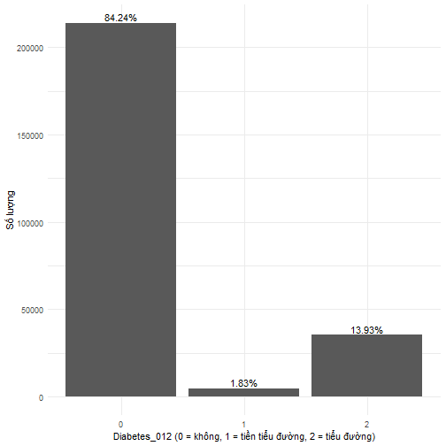
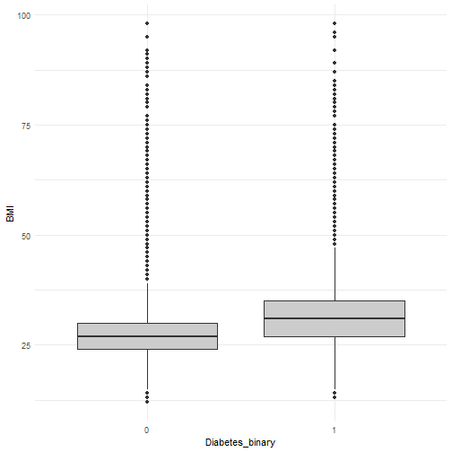
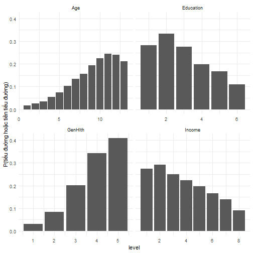
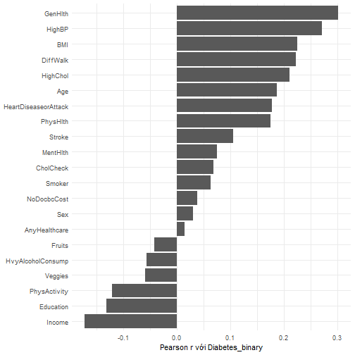

## Biến mục tiêu


``` r
class_dist <- df |> count(Diabetes_012) |> mutate(pct = round(100 * n / sum(n), 2))
class_dist
```

```
##   Diabetes_012      n   pct
## 1            0 213703 84.24
## 2            1   4631  1.83
## 3            2  35346 13.93
```

``` r
save_csv(class_dist, "eda_class_distribution")

ggplot(class_dist, aes(factor(Diabetes_012), n)) +
  geom_col() + geom_text(aes(label = paste0(pct, "%")), vjust = -0.3) +
  labs(x = "Diabetes_012 (0 = không, 1 = tiền tiểu đường, 2 = tiểu đường)", y = "Số lượng") +
  theme_minimal()
```



Dữ liệu mất cân bằng nặng; gộp 1 và 2 thành `Diabetes_binary` đưa tỉ lệ nhóm dương lên 15.76%.

## BMI


``` r
bmi_summary <- df |> group_by(Diabetes_012) |>
  summarise(n = n(), mean = mean(BMI), median = median(BMI), sd = sd(BMI))
bmi_summary
```

```
## # A tibble: 3 × 5
##   Diabetes_012      n  mean median    sd
##          <dbl>  <int> <dbl>  <dbl> <dbl>
## 1            0 213703  27.7     27  6.26
## 2            1   4631  30.7     30  6.96
## 3            2  35346  31.9     31  7.36
```

``` r
save_csv(bmi_summary, "eda_bmi_by_class")

ggplot(df, aes(factor(Diabetes_binary), BMI)) + geom_boxplot(fill = "grey80") +
  labs(x = "Diabetes_binary") + theme_minimal()
```



## Biến nhị phân: tỉ lệ theo nhóm


``` r
prev <- sapply(BINARY_VARS, \(v) tapply(df[[v]], df$Diabetes_binary, mean) * 100) |>
  t() |> as.data.frame() |> setNames(c("khong_tieu_duong_pct", "tieu_duong_pct")) |>
  rownames_to_column("variable")
prev
```

```
##                variable khong_tieu_duong_pct tieu_duong_pct
## 1                HighBP            37.113190      73.834955
## 2              HighChol            37.917109      66.440703
## 3             CholCheck            95.710402      99.242064
## 4                Smoker            42.968044      51.527128
## 5                Stroke             3.162801       8.837582
## 6  HeartDiseaseorAttack             7.183334      21.367286
## 7          PhysActivity            77.907657      63.609075
## 8                Fruits            64.302326      58.738775
## 9               Veggies            82.143910      75.786077
## 10    HvyAlcoholConsump             6.184284       2.601496
## 11        AnyHealthcare            94.973866      95.807589
## 12          NoDocbcCost             7.961049      10.858744
## 13             DiffWalk            13.228172      36.035721
## 14                  Sex            43.398548      47.432274
```

``` r
save_csv(prev, "eda_binary_prevalence")
```

## Biến thứ bậc: **tỉ lệ** bệnh theo từng mức (không dùng số đếm thô)

Số đếm trong nhóm bệnh bị chi phối bởi cỡ mẫu của từng mức, nên không dùng để kết luận
"bệnh tập trung ở nhóm thu nhập/học vấn cao". Tỉ lệ bệnh theo mức mới là thước đo đúng.


``` r
ord_rates <- bind_rows(lapply(ORDINAL_VARS, \(v)
  df |> group_by(level = .data[[v]]) |>
    summarise(n = n(), diabetes_rate = mean(Diabetes_binary), .groups = "drop") |>
    mutate(variable = v)))
save_csv(ord_rates, "eda_ordinal_diabetes_rate")

ggplot(ord_rates, aes(level, diabetes_rate)) + geom_col() +
  facet_wrap(~variable, scales = "free_x") +
  labs(y = "P(tiểu đường hoặc tiền tiểu đường)") + theme_minimal()
```



``` r
tibble(pair = "Age x Education", cramers_v = cramers_v(df$Age, df$Education))
```

```
## # A tibble: 1 × 2
##   pair            cramers_v
##   <chr>               <dbl>
## 1 Age x Education    0.0702
```

Age và Education có liên hệ yếu-vừa, nhưng **Education vẫn được giữ** vì IV của nó (0.128) vượt ngưỡng
chọn biến ở chương 04. (Báo cáo gốc nói loại Education ở mục 2.5 nhưng sau đó vẫn dùng nó.)

## Tương quan Pearson với biến mục tiêu


``` r
cors <- tibble(variable = PREDICTORS,
               correlation = sapply(PREDICTORS, \(v) cor(df[[v]], df$Diabetes_binary))) |>
  arrange(desc(abs(correlation)))
save_csv(cors, "eda_pearson_with_target")

ggplot(cors, aes(reorder(variable, correlation), correlation)) + geom_col() +
  coord_flip() + labs(x = NULL, y = "Pearson r với Diabetes_binary") + theme_minimal()
```


