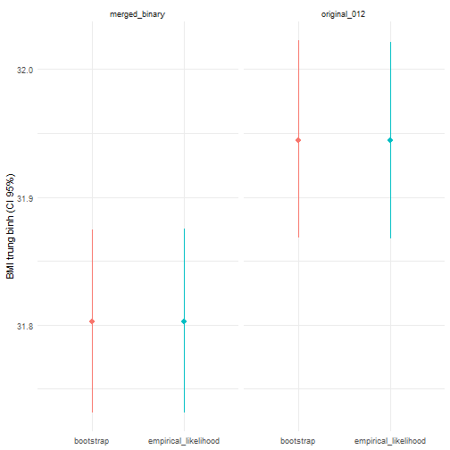

Hai cách mã hóa: **biến gốc** (so nhóm 2 với nhóm 0, bỏ tiền tiểu đường) và **biến gộp** (1 và 2 vs 0).


``` r
scenarios <- list(
  original_012  = list(case = df$BMI[df$Diabetes_012 == 2],      control = df$BMI[df$Diabetes_012 == 0]),
  merged_binary = list(case = df$BMI[df$Diabetes_binary == 1],   control = df$BMI[df$Diabetes_binary == 0])
)
```

## CI 95% cho BMI trung bình


``` r
mean_ci <- bind_rows(lapply(names(scenarios), \(s)
  bind_rows(lapply(c("case", "control"), \(g) {
    x <- scenarios[[s]][[g]]
    bind_rows(boot_mean_ci(x, B) |> mutate(method = "bootstrap"),
              el_mean_ci(x)      |> mutate(method = "empirical_likelihood")) |>
      mutate(scenario = s, group = g, n = length(x), width = upper - lower)
  })))) |>
  select(scenario, group, n, method, estimate, lower, upper, width)
mean_ci
```

```
## # A tibble: 8 × 8
##   scenario      group        n method               estimate lower upper  width
##   <chr>         <chr>    <int> <chr>                   <dbl> <dbl> <dbl>  <dbl>
## 1 original_012  case     35346 bootstrap                31.9  31.9  32.0 0.154 
## 2 original_012  case     35346 empirical_likelihood     31.9  31.9  32.0 0.154 
## 3 original_012  control 213703 bootstrap                27.7  27.7  27.8 0.0530
## 4 original_012  control 213703 empirical_likelihood     27.7  27.7  27.8 0.0531
## 5 merged_binary case     39977 bootstrap                31.8  31.7  31.9 0.143 
## 6 merged_binary case     39977 empirical_likelihood     31.8  31.7  31.9 0.144 
## 7 merged_binary control 213703 bootstrap                27.7  27.7  27.8 0.0526
## 8 merged_binary control 213703 empirical_likelihood     27.7  27.7  27.8 0.0531
```

``` r
save_csv(mean_ci, "bmi_mean_ci")

# Hai kịch bản có trung bình nhóm bệnh khác nhau nên EL phải khác nhau.
# (Bản PDF gốc in cùng một kết quả EL cho cả hai mục.)
el_case <- mean_ci |> filter(group == "case", method == "empirical_likelihood")
stopifnot(abs(el_case$lower[1] - el_case$lower[2]) > 0.01)
```


``` r
mean_ci |> filter(group == "case") |>
  ggplot(aes(method, estimate, ymin = lower, ymax = upper, colour = method)) +
  geom_pointrange() + facet_wrap(~scenario) +
  labs(x = NULL, y = "BMI trung bình (CI 95%)") +
  theme_minimal() + theme(legend.position = "none")
```



## Chênh lệch BMI giữa nhóm bệnh và nhóm không bệnh (bootstrap)


``` r
diff_ci <- bind_rows(lapply(names(scenarios), \(s)
  boot_diff_ci(scenarios[[s]]$case, scenarios[[s]]$control, B) |> mutate(scenario = s))) |>
  select(scenario, everything())
diff_ci
```

```
## # A tibble: 2 × 4
##   scenario      estimate lower upper
##   <chr>            <dbl> <dbl> <dbl>
## 1 original_012      4.20  4.12  4.28
## 2 merged_binary     4.06  3.98  4.14
```

``` r
save_csv(diff_ci, "bmi_difference_ci")
```

**Kết luận.** BMI trung bình của nhóm bệnh nằm ở mức béo phì độ 1 (BMI 30–34.9) trong cả hai cách mã hóa;
chênh lệch so với nhóm không bệnh khoảng 4 đơn vị BMI và khoảng tin cậy không chứa 0.
Bootstrap và EL cho khoảng gần như trùng nhau do cỡ mẫu lớn.
