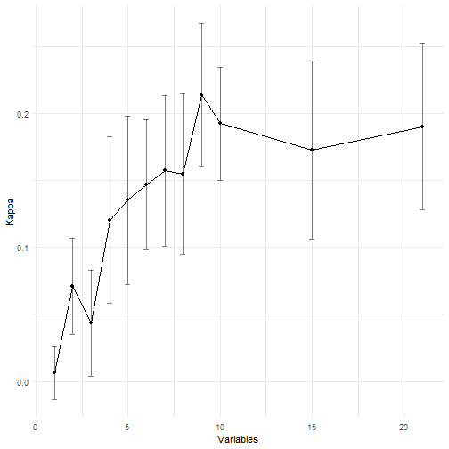

Một cấu hình duy nhất cho toàn repo (bản gốc có hai lần chạy khác nhau: 8000 và 5000 mẫu, cho top-5 khác nhau):
mẫu 5000 quan sát từ tập **train**, CV 10 lần, 200 cây, chọn kích thước nhỏ nhất trong vòng 1% Kappa so với tốt nhất.
Chạy trên biến thô (số), không dùng nhãn nào khác làm biến giải thích.


``` r
set.seed(SEED)
train <- df[split_data(df)$train |> rownames() |> as.integer(), ]
samp  <- train[sample(nrow(train), 5000), ]
x <- samp[, PREDICTORS]; assert_no_target(names(x))
y <- factor(samp$Diabetes_binary, levels = 0:1, labels = c("No", "Yes"))

ctrl <- rfeControl(functions = rfFuncs, method = "cv", number = 10)
ctrl$functions$selectSize <- \(x, metric, maximize) pickSizeTolerance(x, metric, tol = 1, maximize)

fit <- rfe(x, y, sizes = c(1:10, 15, 21), rfeControl = ctrl, metric = "Kappa", ntree = 200)
fit
```

```
## 
## Recursive feature selection
## 
## Outer resampling method: Cross-Validated (10 fold) 
## 
## Resampling performance over subset size:
## 
##  Variables Accuracy    Kappa AccuracySD KappaSD Selected
##          1   0.8436 0.006325   0.002361 0.02000         
##          2   0.8444 0.071024   0.006636 0.03592         
##          3   0.8448 0.043391   0.004382 0.03972         
##          4   0.8420 0.120191   0.007522 0.06220         
##          5   0.8444 0.135143   0.008453 0.06259         
##          6   0.8460 0.146926   0.006833 0.04861         
##          7   0.8482 0.157142   0.008979 0.05637         
##          8   0.8480 0.154924   0.007801 0.06026         
##          9   0.8460 0.213779   0.008978 0.05323        *
##         10   0.8450 0.192327   0.005753 0.04209         
##         15   0.8444 0.172878   0.010158 0.06642         
##         21   0.8470 0.190229   0.011003 0.06246         
## 
## The top 5 variables (out of 9):
##    GenHlth, BMI, DiffWalk, HighChol, HighBP
```


``` r
baseline <- max(prop.table(table(y)))
cat("Accuracy khi đoán toàn lớp đa số:", round(baseline, 4), "\n")
```

```
## Accuracy khi đoán toàn lớp đa số: 0.843
```

``` r
res <- fit$results
save_csv(res, "rfe_results")
save_csv(tibble(feature = predictors(fit)), "rfe_selected")
predictors(fit)
```

```
## [1] "GenHlth"              "BMI"                  "DiffWalk"            
## [4] "HighChol"             "HighBP"               "HeartDiseaseorAttack"
## [7] "Age"                  "PhysHlth"             "Income"
```

``` r
ggplot(res, aes(Variables, Kappa)) +
  geom_line() + geom_point() +
  geom_errorbar(aes(ymin = Kappa - KappaSD, ymax = Kappa + KappaSD), width = 0.3, alpha = 0.5) +
  theme_minimal()
```



**Đọc kết quả.** Accuracy giữa các kích thước tập biến chênh nhau trong phạm vi độ lệch chuẩn của CV và chỉ nhỉnh baseline
đoán toàn lớp 0, nên dùng Kappa để so sánh. Kết luận an toàn là một tập nhỏ (khoảng 5 biến: GenHlth, BMI, HighBP, Age, DiffWalk
hoặc tương tự) đạt hiệu năng ngang 21 biến, không phải một tập "tối ưu" duy nhất.
